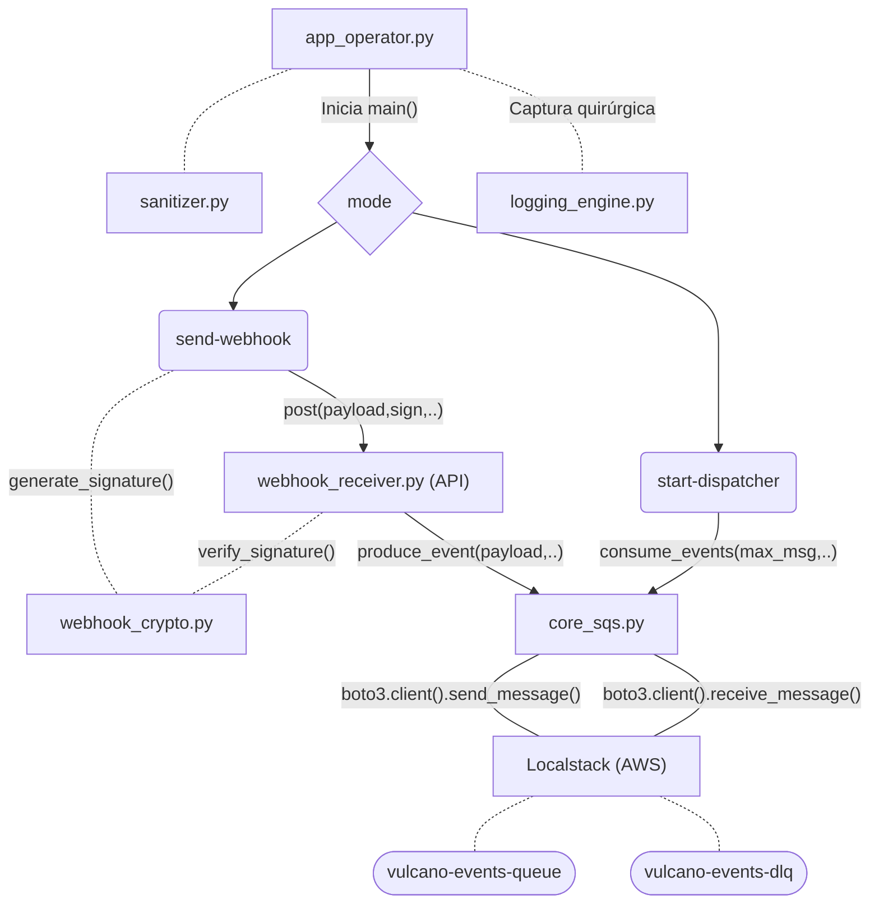

# Proyecto Vulcano

Vulcano Engine es un sistema de recepción, procesamiento y despacho de eventos mediante webhooks, desarrollado en Python. Su arquitectura utiliza Amazon SQS para gestionar el procesamiento asíncrono de mensajes, permitiendo desacoplar la recepción de eventos de su posterior distribución.

Contempla mecanismos de validación de firmas HMAC para verificar la autenticidad e integridad de los webhooks, gestión de mensajes fallidos mediante Dead Letter Queue (DLQ) y registro de eventos para facilitar la trazabilidad y el análisis de errores.

El proyecto utiliza LocalStack para emular los servicios de AWS durante el desarrollo y las pruebas locales.

### Componentes principales

- **Webhook Receiver**: recibe solicitudes HTTP, valida su firma y publica los eventos en una cola SQS.
- **SQS**: almacena los eventos para su procesamiento asíncrono.
- **Dispatcher**: consume los mensajes de la cola y los reenvía al destino configurado.
- **Dead Letter Queue (DLQ)**: recibe los mensajes que superan el límite de intentos de procesamiento.
- **Logging**: registra información de ejecución y eventos relevantes para facilitar el seguimiento y diagnóstico.

### Tecnologías utilizadas

El proyecto utiliza las siguientes tecnologías y herramientas:

| Tecnología      | Uso |
|-----------------|-----|
| Python          | Lenguaje principal de desarrollo. |
| FastAPI         | Desarrollo del endpoint HTTP para la recepción de webhooks. |
| Uvicorn         | Servidor ASGI para ejecutar la aplicación FastAPI. |
| Amazon SQS      | Servicio de colas utilizado para la gestión asíncrona de eventos. |
| Boto3 / Botocore| SDK de AWS para interactuar con los servicios de SQS. |
| LocalStack      | Emulación local de servicios de AWS durante el desarrollo y las pruebas. |
| Docker Compose  | Configuración y ejecución del entorno local de LocalStack. |
| Requests        | Envío de solicitudes HTTP durante el despacho de eventos. |
| Python-dotenv   | Carga de variables de entorno desde archivos `.env`. |
| Pytest          | Ejecución de pruebas automatizadas. |

### Dependencias principales

Las dependencias del proyecto se encuentran declaradas en `requirements.txt`.

### Requisitos

- Python 3.11 o superior

## Instalación

1.  Clonar el repositorio

    1. Ve a la carpeta donde quieres guardar el proyecto:
        
        ```bash
        cd ruta/de/la/carpeta
        ```

    2. Clona el repositorio:
        
        ```bash
        git clone git@github.com:mamanicristian92/vulcano_engine.git
        ```

        *Nota: el comando utiliza SSH. Asegurate de tener configurada una clave SSH en GitHub.*

    3. Entra al proyecto:
        
        ```bash
        cd vulcano_engine
        ```

2. Entorno virtual:
    
    1. Crear el entorno (dentro de la carpeta del proyecto):
        
        - Windows (CMD / Powershell):

            ```bash
            python -m venv .venv
            ```
        
        - Linux / macOS:

            ```bash
            python3 -m venv .venv
            ```
        
        *Esto crea una carpeta llamada `.venv`*
    
    2. Activar el entorno virtual

        - Windows (CMD):

            ```bash
            .venv\Scripts\activate
            ```

        - Windows (PowerShell):

            ```bash
            .\.venv\Scripts\Activate.ps1
            ```

        - Linux / macOS:
            
            ```bash
            source .venv/bin/activate
            ```
        
        - Cuando esté activado, normalmente verás algo como:

            ```bash
            (.venv) $
            ```

3. Instalar paquetes:
    
    - Con el entorno activado:

        ```bash
        python -m pip install -r requirements.txt
        ```

4. Configurar el archivo .env

    Copiá el archivo de configuración de ejemplo:

    - Windows (CMD):

        ```bash
        copy .env.example .env
        ```

    - Linux / macOS /Powershell:

        ```bash
        cp .env.example .env
        ```

    - Pon tus claves en el .env

        ```
        AWS_ACCESS_KEY_ID=
        AWS_SECRET_ACCESS_KEY=
        WEBHOOK_SECRET=
        ```

## Cómo Usar

1. Levantar Localstack (con Docker instalado y corriendo en el sistema)

    - Desde la carpeta del proyecto:

        ```bash
        docker compose up -d
        ```
    
    - Revisar que esté en ejecución:

        ```bash
        docker ps
        ```

        Nota: Esto crea y levanta localstack; además crea la cola de eventos (si aún no está creada)

2. Levantar Receptor HTTP weebhook_receiver

    - En otra terminal (con el **entorno activado** y en la carpeta raíz):

        ```bash
        python -m uvicorn src.vulcano_telemetry.webhook_receiver:app --reload
        ```

3. En otra terminal (con el entorno activado) ejecutamos app_operator.py

    - Enviar un mensaje a la cola de eventos:

        ```bash
        python src/app_operator.py send-webhook
        ```

    - Consumir mensajes de la cola de eventos:

        ```bash
        python src/app_operator.py start-dispatcher
        ```

#### Anatomía:

|Argument         |Description                                   |
|-----------------|----------------------------------------------|
|send-webhook     |Enviar un Webhook HTTP de prueba              |
|start-dispatcher |Consumir eventos de SQS y enviar a Webhooks   |
|produce-sqs      |Publicar eventos en la cola SQS               |
|start-receiver   |Iniciar el receptor de Webhooks HTTP          |

|Flag       |Short|Description                    |Default                        |
|-----------|-----|-------------------------------|-------------------------------|
|--queue    | -q  |Nombre de la cola SQS          |vulcano-events-queue           |
|--wait-time| -w  |Tiempo de Long Polling [1-20]  | 10                            |
|--url      |     |URL del Webhook Receptor       | WEBHOOK_URL (.env)            |
|--secret   |     |Clave secreta HMAC             | WEBHOOK_SECRET (.env)         |

**Ejemplo:**

Usar una clave distinta a la default:

```bash
python src/app_operator.py send-webhook --secret mi_clave_equivocada_no_tan_secreta_456
```

*Esto generará un 401 Unauthorized en el webhook_receiver*

---

### Calidad y pruebas

El proyecto cuenta con pruebas automatizadas y herramientas de análisis estático
(Flake8 y Pylint) para verificar su correcto funcionamiento y mantener la
calidad del código.

Para conocer cómo ejecutar las pruebas y las herramientas de análisis,
consultar [CONTRIBUTING.md](CONTRIBUTING.md).

---

###  Diagrama de Arquitectura de Telemetría



---

### Equipo de desarrollo

### Equipo 404

- Integrante 1: [Lescano, Jessica Daiana](https://www.github.com/daylagitana89jl-oss)
- Integrante 2: [Venticola, Leandro Enrique](https://github.com/leoventicola/)
- Integrante 3: [Cointte Cedron, Mateo](https://github.com/Th-30Mateo)
- Integrante 4: [Choque, Ismael Alejandro](https://www.github.com/ismahack7)
- Integrante 5: [Martinez, Gustavo Alejandro](https://www.github.com/gusmz111)
- Integrante 6: [Mamaní, Cristian Alfredo](https://www.github.com/mamanicristian92)

### Video de presentación

